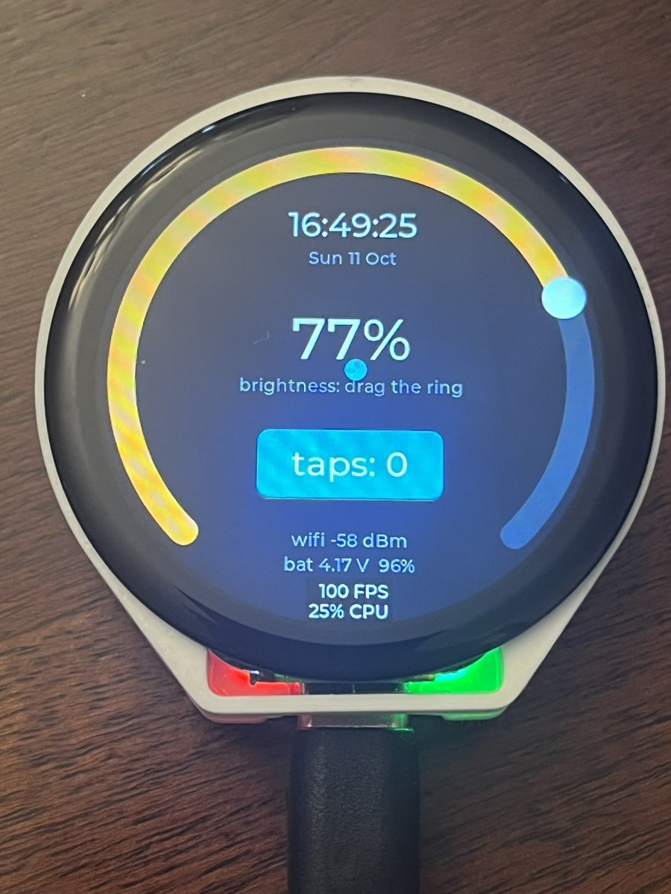
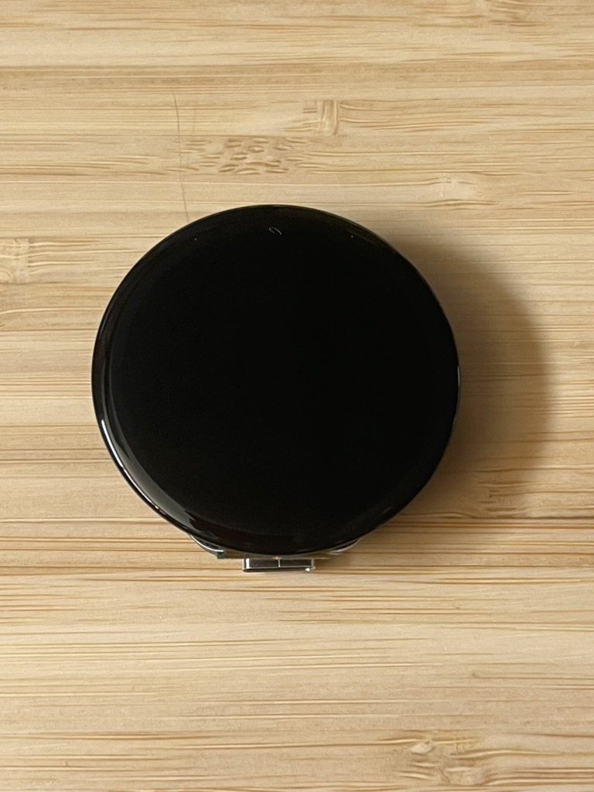
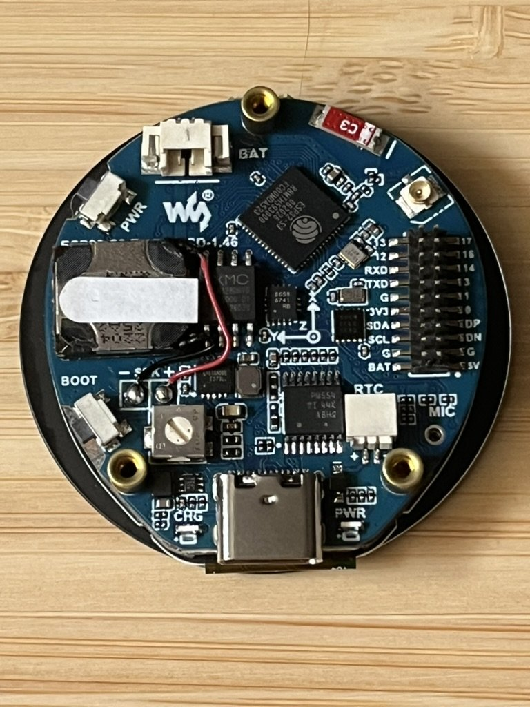
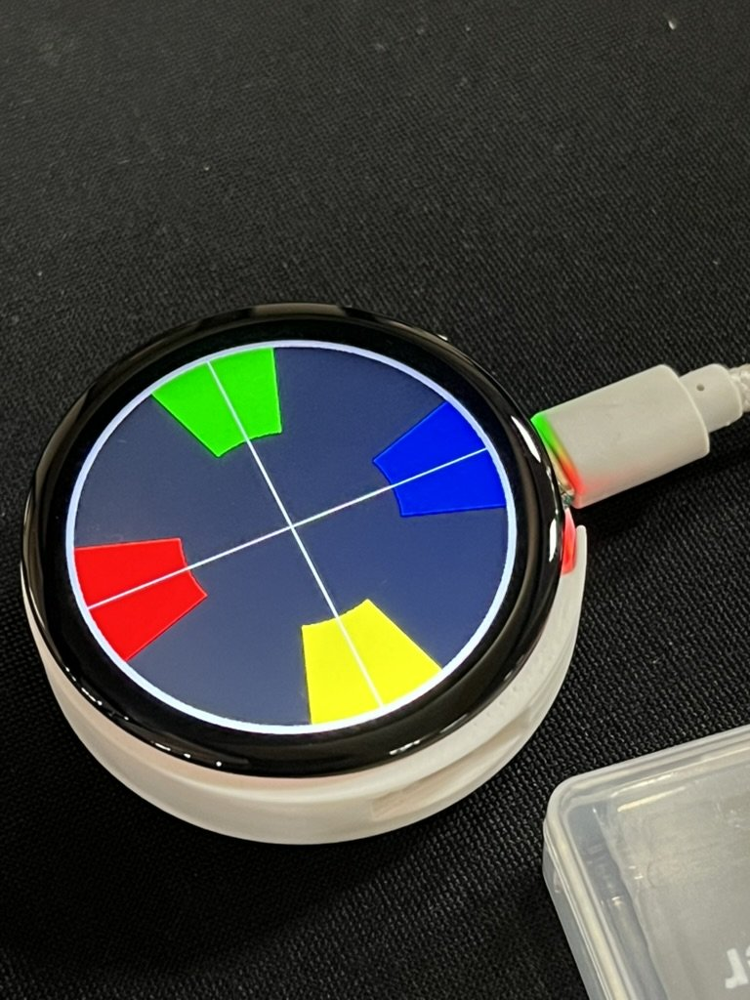

# waveshare-esp32s3-146-round

Firmware and a 3D-printed pocket-watch case for the Waveshare
ESP32-S3-Touch-LCD-1.46, a round 1.46in 412 x 412 touch screen with an
ESP32-S3 on the back.

The firmware brings up the whole board and runs a demo on the round screen:

- a ring around the rim you drag to set the backlight brightness
- the local time and date at 12 o'clock, kept by the onboard real-time clock
  and set over Wi-Fi from internet time (NTP)
- a spirit-level bubble driven by the motion sensor
- the battery voltage at 6 o'clock, and a tap counter button
- the PWR button: a short press toggles the screen, a 2 second hold powers
  off

This is a work in progress. It runs on USB power today; running from a
battery is not finished yet (see [What's not done](#whats-not-done)).

<p align="center">
  
</p>

## What you need

<p align="center">
  
  
</p>

| Item | Notes |
| --- | --- |
| Waveshare ESP32-S3-Touch-LCD-1.46, **with cover glass** (SKU 29565) | [waveshare.com/esp32-s3-touch-lcd-1.46.htm](https://www.waveshare.com/esp32-s3-touch-lcd-1.46.htm). The firmware should also suit the glassless 1.46B (SKU 29564), but the case is built around the cover glass and has not been tried with it. |
| USB-C cable that carries data | Some charge-only cables power the board but the computer never sees it. |
| A computer with Python 3 and git | macOS or Linux. Windows should work with PlatformIO but has not been tried. |
| A 3D printer (optional) | Only for the case. |
| A 2.4 GHz Wi-Fi network (optional) | Only for setting the clock automatically. 5 GHz networks do not work. |

No soldering, no extra parts, and no buttons to press while flashing.

## Build and flash the firmware

**1. Install PlatformIO Core**, the command-line build tool. Either of these
works:

```sh
brew install platformio     # macOS with Homebrew
pipx install platformio     # macOS or Linux with pipx
```

Check that `pio --version` prints a version.

On Linux, also install PlatformIO's udev rules so you can use the USB port
without root, then unplug and replug the board:

```sh
curl -fsSL https://raw.githubusercontent.com/platformio/platformio-core/develop/platformio/assets/system/99-platformio-udev.rules | sudo tee /etc/udev/rules.d/99-platformio-udev.rules
sudo udevadm control --reload-rules && sudo udevadm trigger
```

**2. Get the code:**

```sh
git clone https://github.com/ugufru/waveshare-esp32s3-146-round.git
cd waveshare-esp32s3-146-round
```

**3. Plug the board in** with the USB-C cable.

**4. Build and flash:**

```sh
pio run -t upload
```

The first run downloads the compiler and libraries (several hundred MB into
`~/.platformio`) and takes a few minutes. Later builds are much faster.
Every version is pinned in `platformio.ini`, so you get exactly the toolchain
this was built with. PlatformIO finds the board's USB port by itself.

When it finishes, the board restarts and the demo appears on the screen.

**5. Watch the serial output (optional):**

```sh
pio device monitor
```

You should see the board's start-up messages, including `psram 8388608 bytes
(found)`. Press Ctrl-C to quit.

Flashing replaces the demo firmware the board shipped with. To put that
back, flash Waveshare's factory image from the `Firmware` folder of
[waveshareteam/ESP32-S3-Touch-LCD-1.46](https://github.com/waveshareteam/ESP32-S3-Touch-LCD-1.46)
(details in [docs/BUILD.md](docs/BUILD.md)).

### If the upload cannot find the board

- Try another USB-C cable (see above) or another USB port.
- Hold **BOOT** while you unplug and replug the board, then run the upload
  again. This forces the chip into its download mode. PWR and BOOT are the
  two small buttons on the edge of the board.

## Set the clock

The time shows `--:--:--` until it has been set once. After that the
onboard clock keeps it. Settings are sent as text commands over the USB
serial port.

First find the port name:

```sh
ls /dev/cu.usbmodem*   # macOS, for example /dev/cu.usbmodem101
ls /dev/ttyACM*        # Linux, for example /dev/ttyACM0
```

Use that name in place of `PORT` below. Close `pio device monitor` first if
it is running.

**Automatically, over Wi-Fi.** Store your network name and password (they
are kept on the board and never printed back):

```sh
printf '%s\n' 'wifi "NETWORK NAME" "PASSWORD"' > PORT
```

The board connects and sets the clock from internet time, and does so again
each time it starts.

**Your time zone.** The clock shows UTC until you give it your offset from
UTC in minutes. For example, US Eastern daylight time is 4 hours behind UTC:

```sh
printf 'tz -240\n' > PORT
```

**Without Wi-Fi**, set the time from your computer's clock and the offset in
one go:

```sh
printf 't %d -240\n' $(date +%s) > PORT
```

All the commands are listed in [docs/BUILD.md](docs/BUILD.md#serial-commands).

## Print the case

The current case is a back cup: the board drops into it, and the board's
own curved cover glass is the front of the watch. USB-C stays reachable at
6 o'clock, the microSD slot at 9 o'clock, and there are pinholes for PWR and
BOOT.

- File: [`pocketwatch/back_cup_v12.stl`](pocketwatch/back_cup_v12.stl)
- Print it base down. No supports needed.
- It needs the cover-glass board (SKU 29565).

For now the board just sits in the cup. Screws to hold it are not settled
yet: Waveshare's drawing says the board's mounting posts take M2 screws, but
M2 screws do not fit them.

The other STLs in `pocketwatch/` are earlier versions, kept for reference.
The photo at the top shows v1.2. This is v1.1, running the first display
test pattern:

<p align="center">
  
</p>

[pocketwatch/README.md](pocketwatch/README.md) has the history and
measurements. To change the design, edit `pocketwatch/pocketwatch.scad` and
rebuild the STLs with `make stl` (needs [OpenSCAD](https://openscad.org/)).

## What's not done

The full list, with the planned order, is in `issues.jsonl` and
`roadmap.jsonl` (open `issues.html` in a browser for a readable view).
The main gaps:

- **Battery power.** The board has a LiPo socket and charger, and the
  firmware has the code to stay on and power off on battery, but none of it
  has been tried on a real cell yet. Do not rely on it.
- **Room for a battery in the case.** The current cup has no space behind
  the board for one.
- **Screws** to hold the board in the case.
- Wi-Fi setup without a USB cable, and firmware updates over Wi-Fi.
- Audio, microSD and the speaker/mic openings in the case.

## More detail

- [docs/BUILD.md](docs/BUILD.md): toolchain choices, serial commands,
  recovery, and backing up or restoring the factory firmware
- [docs/board-specs.md](docs/board-specs.md): the board's specs and
  dimensions, with links to Waveshare's schematic and drawings
- [docs/pins.md](docs/pins.md): which ESP32-S3 pin does what
- [CONTRIBUTING.md](CONTRIBUTING.md): how changes are made here

## Credits and licences

This project's own firmware, case designs, tools and docs are MIT licensed
(see [LICENSE](LICENSE)), except for one bundled library:

- `lib/esp_lcd_spd2010/` is Espressif's SPD2010 display driver, Apache-2.0,
  copied unmodified (see its `VENDORED.md`).
